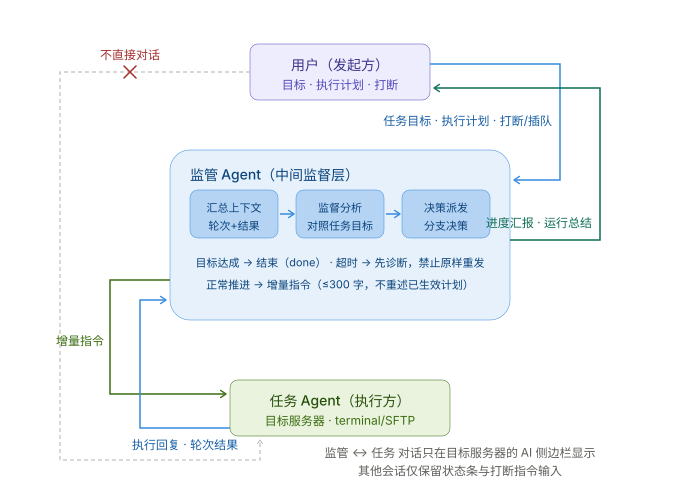
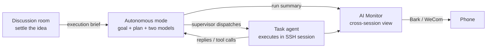

# Netcatty · AI workbench branch

> A Windows build maintained on top of [binaricat/Netcatty](https://github.com/binaricat/Netcatty) (GPL-3.0).
> Upstream is an SSH manager and terminal; this branch adds an **AI orchestration layer** on top of it —
> so the AI does not just answer questions, but reasons a plan through in a discussion room, drives a
> long-running task to completion by itself, is supervised from a single dashboard, and executes
> **directly on remote servers**.

中文版：[README.zh-CN.md](README.zh-CN.md) · Freeze post-mortem: [docs/freeze-fix.md](docs/freeze-fix.md)

## Four core capabilities

| Capability | In one line | Where |
| --- | --- | --- |
| **AI Monitor** | Every AI task across every server, in one place | Top tab "AI 监控台" |
| **Discussion room** | Think it through before the AI acts | AI sidebar → 研讨 |
| **Autonomous mode** | A supervisor agent drives a task agent to completion | AI sidebar → 自主模式 |
| **Local agent × remote server** | The agent runs on your machine, commands run on the server | AI sidebar of any SSH / serial session |

---

## 1. AI Monitor — every AI task across every server, in one place

A workstation usually holds a dozen SSH sessions, each with its own AI conversation. Switching between
them just to check progress is the expensive part. This page aggregates **all AI tasks on all servers**.

- **Aggregate and filter** — session list on the left, a live "N tasks running" counter, filter by all / running; each row is tagged main conversation or branch, and shows which host it belongs to
- **Detail pane** — expand to read the full conversation and tool calls without going back to that terminal
- **Continue in place** — type a follow-up right in the detail pane (a running task tells you to wait instead of breaking its stream)
- **Stop a task** — one click to kill a runaway task, across hosts
- **Jump back to the terminal** — open the real session when you need raw output; a closed terminal is reported explicitly

### Companion: phone monitoring

- **LAN web page** — open the monitor URL in a phone browser; same LAN, or both sides on Tailscale and use its IP
- **Bark push** — notify an iPhone when a task finishes or errors
- **WeCom group bot** — webhook notification carrying a link back into the conversation

> Push and snapshots depend on the desktop AI panel being open; the monitor service needs an app restart the first time it is enabled.

---

## 2. Discussion room — think it through before the AI acts

Most failed AI work is not a model problem: the task was never specified. The discussion room isolates
that step.

- **Discuss, never dispatch** — nothing said here becomes an instruction to the task agent
- **The supervisor agent has full permissions** — it is not a chat-only advisor; it holds the same tools as the task agent and can **read the project code and experiment logs**, so its opinions are grounded in real files
- **Switchable model** — pick a different discussion model per round (effective immediately), or follow the app default
- **Custom prompt** — save a "reply notes" prompt injected into the system prompt: tone, form of address, level of detail, whether sources are mandatory
- **Edit like a conversation** — edit a message (truncating everything after it and restarting from there), **branch** from a reply while keeping the main thread, or select text and **quote** it into the next round

### Closing the loop: the execution brief

One click on "generate execution brief" structures the discussion into six parts:

**Goal · Approach · Step plan · Key constraints · Acceptance criteria · Risks & open questions**

"Apply to autonomous mode" then fills the goal and initial plan directly, and feeds the brief to the
supervisor as context. **From talking to doing is one click — no restating the requirement.**

---

## 3. Autonomous mode — a supervisor agent drives a task agent

The discussion room settles *what*; autonomous mode handles *running it to the end*. Two roles:

- **Supervisor agent (the brain)** — reads the goal, reads the task agent's reply, decides what to dispatch next, judges whether the goal is met
- **Task agent** — the one actually running commands, editing files, executing experiments

You only talk to the supervisor; it reads results and decides the next step itself.

  

### Two run modes

| Mode | Behaviour | Fits |
| --- | --- | --- |
| **List mode** | Dispatches the task list you provide, one item after another | Clear, ordered steps |
| **Think mode** | Reuses the current AI provider, reads goal + history + last reply, then decides the next instruction itself and ends on its own when it judges the goal met. The initial plan is an optional hint | Exploratory work needing judgement calls |

### Two models

The supervisor brain and the task agent can use **different models**: a strong reasoning model to decide,
a cheaper or better-at-execution model to act. Neither affects ordinary chats. A change made mid-run
takes effect from the **next dispatch**.

### Budgets and circuit breakers

It is not fire-and-forget — hard limits stop it:

- **Round cap** and **wall-clock cap**
- **Stall limit** — stop after N rounds without real progress
- **Consecutive-error limit** — stop after N errors in a row

States: `idle` / `running` / `stopped` / `completed` / `budget exhausted` / `stalled` / `error loop`.
The UI shows "round 3/8" and "12/60 min" live.

### Intervention

- **Stop supervising** — aborts the current reply and **blocks all further dispatch**, not just this round
- **Pause** — keeps context, resume anytime
- **Interrupt / cut in** — inject a new instruction mid-run without waiting for the round to end

### Run summary and history

- On completion it auto-generates a summary: experiment progress + key results + next steps
- **The summary prompt is configurable** — perspective, section split (e.g. by experiment phase), length, format, e.g. "summarise by data prep / training / evaluation; next steps must be the smallest action completable this week"
- Summaries can be copied and reviewed by version; a failed one can be regenerated manually
- Every supervisor run is archived as **read-only history**, replayable round by round

---

## 4. Local agent × remote server

This is the foundation: **the AI runs where you control it, the work happens on the server.**

- **Use the CLI / SDK agents you already have** — Claude Code, Codex CLI, Cursor (SDK or `cursor-agent login`), GitHub Copilot CLI, CodeBuddy Code, OpenCode, Grok Build. Detected automatically, or point at an executable
- **Nothing to install on the server** — the agent process is local; its shell commands are proxied into the terminal session (SSH or serial), so the remote side only carries the command
- **Credentials never leave your machine** — model API keys and CLI logins stay local; only concrete commands reach the remote host
- **Command guardrails** — a command blocklist, validation against the remote shell type (bash / zsh / fish / powershell…), and an approval card for high-risk commands; network devices and serial sessions take a separate path
- **One chat, many hosts** — `@`-mention connected hosts in the composer to work across machines

---

## How they connect

In one sentence: **the discussion room sets direction, autonomous mode carries it out, the monitor holds
your attention, and the local agent keeps execution on real servers.**

---

## Other fixes (vs upstream)

- **Whole-window freeze ~10 s after launch** — the auto run-summary effect and a `useCallback` dependency formed a self-feeding loop (~127 commits/s). Fixed with a latch and a tighter guard; verified with a 55 s continuous heartbeat on the full original dataset. Details in [docs/freeze-fix.md](docs/freeze-fix.md)
- **AI panel rendering** — timeline renders the newest 60 events (older ones collapse), task output capped at 10, streaming buffer skips `setState` when unchanged, scroll writes de-duplicated
- **Model catalog retry** — no longer retries forever when the catalog loads but is empty
- **Packaging and diagnostics** — `scripts/update-sokai.cjs` for one-shot repacking, `scripts/_diag_heartbeat.cjs` as the only trustworthy freeze probe (single-shot probes give false positives)
- **SFTP dialogs** — rename / new-folder / new-file / delete failures surfaced a silent `console.warn` only, so the dialog stayed open with no feedback; they now toast the real error (e.g. remote permission denied)
- **SFTP toolbar overflow** — under 400 px the refresh / new-folder / new-file / show-hidden buttons were force-collapsed into the ⋮ menu, ignoring user customization; replaced with measured row-capacity overflow so narrow sidebars keep buttons inline
- **Cloud sync (GitHub Gist) 401** — a connected-but-failing provider showed no error and no way to re-authenticate; the provider card now renders the error inline plus a "Reconnect" button (device flow re-authorization)
- **In-app settings** — the settings gear now toggles a full-width panel docked below the top bar (no resizable side panel, no in-page close button); the stale `false` return on the close path no longer triggers a bogus "settings unavailable" toast
- **Repo links** — feedback / discussions / source / release links and the update check API all point to this fork instead of upstream

## Relationship to upstream

- Based on [binaricat/Netcatty](https://github.com/binaricat/Netcatty), GPL-3.0-or-later
- `AIMonitorPage` and the `Supervisor*` modules do not exist under `components/ai/` on upstream `main`; they are local additions
- This repository ships documentation plus the changed files (`changed-files/` keeps the original relative paths), not the full project

## Portable build

The release ships a Windows x64 portable archive (~183 MB, ~490 MB extracted):

1. extract anywhere, double-click `Netcatty.exe`
2. no installer, no administrator rights
3. data lives in `%APPDATA%\Netcatty`; create an empty `data` folder next to the exe to make it portable

The archive excludes the user-data directory and historical backups. This is an Electron directory
layout — **do not copy `Netcatty.exe` alone**.

## Limitations

- Verified on Windows x64 only; unsigned, so some AV products may warn
- Autonomous mode spends your own model quota — set round and wall-clock caps before long runs
- This branch is not guaranteed to track upstream continuously

## License

GPL-3.0-or-later. See [LICENSE](LICENSE) and [NOTICE.md](NOTICE.md).
