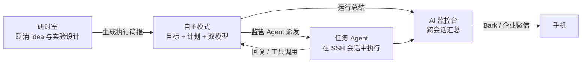

# Netcatty · AI 工作台分支

> 基于 [binaricat/Netcatty](https://github.com/binaricat/Netcatty)（GPL-3.0）维护的 Windows 版本。
> 上游是一个 SSH 管理器与终端；这个分支在它上面加了一层**AI 编排能力**——让 AI 不只回答问题，
> 而是能在一个研讨室里把方案聊清楚、在自主模式里自己跑完、在监控台里被一屏统管，
> 并且直接在**远程服务器**上执行。

English: [README.md](README.md) · 冻结修复复盘：[docs/freeze-fix.md](docs/freeze-fix.md)

## 四个核心能力

| 能力 | 一句话 | 入口 |
| --- | --- | --- |
| **AI 监控台** | 所有服务器上的 AI 任务，一屏统管 | 顶部标签「AI 监控台」 |
| **研讨模式** | 先把想法聊清楚，再让 AI 干活 | AI 侧栏 →「研讨」 |
| **自主模式** | 监管 Agent 驱动任务 Agent 自己跑 | AI 侧栏 →「自主模式」 |
| **本地 Agent × 远程服务器** | agent 跑在本机，命令打在远端 | 任意 SSH/串口会话的 AI 侧栏 |

---

## 一、AI 监控台：所有服务器上的 AI 任务，一屏统管

一台机器上往往同时开着十几个 SSH 会话，每个会话都可能挂着一个 AI 对话，切来切去看进度是最耗神的部分——这个页面把**所有服务器上的 AI 任务**汇总到一处。

- **汇总与筛选**：左侧是全部会话列表，顶部显示「N 个任务运行中」，可按「全部 / 运行中」过滤；每条带「主对话 / 分支」标记，并标明它属于哪个主机
- **右侧详情**：展开即可看到该任务的完整对话与工具调用，不必回到那个终端
- **原地继续**：直接在详情里输入指令继续对话（运行中的任务会提示等待完成，避免打断流式输出）
- **停止任务**：一键中止跨主机的失控任务
- **跳回现场**：需要看真实终端输出时，可跳转到对应的终端会话；终端已关闭会明确提示

### 配套：手机监控

桌面开着的时候，进度不必守在电脑前看：

- **局域网网页**：手机浏览器打开监控地址即可查看；同局域网直连，或两端都装 Tailscale 后用其 IP
- **Bark 推送**：任务回复完成或出错时推送到 iPhone
- **企业微信群机器人**：Webhook 推送通知，并在消息里带指令入口链接

> 推送与快照依赖桌面端 AI 面板处于打开状态；监控服务首次启用需要重启应用生效。

---

## 二、研讨模式：先把想法聊清楚，再让 AI 干活

大多数用 AI 干活失败，不是模型不行，而是**需求没想清楚就让它动手**。研讨室把这一步单独拎出来。

- **只讨论，不派发**：这里的每一句话都不会自动变成对任务 Agent 的指令，先把事情说清楚
- **监管 Agent 有全部权限**：它不是"只会聊天"的顾问——拥有任务 Agent 的全部工具权限，可以**只读核查项目代码与实验记录**，所以它的意见基于真实文件，而不是凭空推测
- **模型可换**：每一轮都可以切换研讨模型（下一轮立即生效），也可以让它跟随应用默认模型
- **提示词可定制**：保存一份「回复注意事项」注入系统提示，控制称呼、语气、详略、是否必须给出来源
- **像讨论一样编辑**：消息可以编辑（发送后截断此后的对话重新开始）、可以**分支**（从某条回复另开一条讨论线，主线保留随时切回）、可以选中文字**引用**进下一轮

### 收尾：生成执行简报

聊完之后点一次「生成执行简报」，研讨结果会被结构化成六段：

**目标 · 总体思路 · 分步计划 · 关键约束 · 验收标准 · 风险与待确认**

再点「应用到自主模式」，这份简报会直接填入自主模式的目标与初始计划，并作为监管大脑的上下文。
**从"聊"到"干"是一次点击，不需要重新复述需求。**

---

## 三、自主模式：监管 Agent 驱动任务 Agent 自己跑

研讨室解决"想清楚"，自主模式解决"跑到底"。这里有两个角色：

- **监管 Agent（大脑）**：读目标、读任务 Agent 的回复、决定下一步派发什么、判断目标是否达成
- **任务 Agent**：真正在终端里执行命令、改文件、跑实验的那个

你只和监管 Agent 对话——它自己看结果、自己决定下一步，不需要你逐条指挥。

### 两种运行模式

| 模式 | 行为 | 适用 |
| --- | --- | --- |
| **清单模式** | 按你给定的任务清单逐条派发，一条做完再下一条 | 步骤明确、顺序固定 |
| **思考模式** | 复用当前 AI Provider，读「目标 + 历史对话 + 上一轮回复」后自行决定下一步指令；判定目标达成时自动结束。初始计划是可选的起点提示 | 探索型任务、需要临场判断 |

### 双模型

监管大脑与任务 Agent 可以**分别指定模型**：大脑用强推理模型做决策，任务 Agent 用性价比更高或更擅长执行的模型，互不影响，也不影响普通对话的模型设置。运行中修改会从**下一次派发**开始生效。

### 预算与熔断

不是"跑起来就不管"，而是有明确边界，超了就停：

- **轮次上限**、**墙钟时长上限**
- **停滞次数**（连续多次没有实质进展就停）
- **连续出错次数**（连续多次报错就停）

对应状态：`待命` / `运行中` / `已停止` / `已完成` / `预算用尽` / `停滞停机` / `连续出错停机`。界面实时显示「轮次 3/8」「时长 12/60 分钟」。

### 干预

- **停止监管**：中止当前回复并**拦截后续所有派发**（不是只停这一轮）
- **暂停**：保留上下文，随时继续
- **打断 / 插队**：运行中也能把新指令塞进去，不必等当前轮结束

### 运行总结与历史

- 运行结束时自动生成「实验项目进度 + 关键结果 + 后续规划」总结
- **总结提示词可自定义**：可指定视角、章节侧重（如按实验阶段拆分）、详略与格式，例如"按数据准备 / 模型训练 / 评测分析三阶段总结；后续规划要给出本周可完成的最小行动"
- 总结支持复制、历史版本回看；失败可手动「重新总结」
- 每次监管运行都会归档成**只读历史**，可回放当时每一轮派发了什么

---

## 四、本地 Agent × 远程服务器

这是整个设计的地基：**AI 跑在你能控制的地方，活儿干在服务器上。**

- **直接接本地已装的 CLI / SDK Agent**：Claude Code、Codex CLI、Cursor（SDK 或 `cursor-agent login`）、GitHub Copilot CLI、CodeBuddy Code、OpenCode、Grok Build。检测到即用，也可手动指定可执行文件路径
- **服务器上什么都不用装**：agent 进程在你本机，它的 shell 命令通过终端会话代理到远端执行（SSH 或串口），远端只承载命令本身
- **凭证不出本机**：模型 API Key、CLI 登录态都留在本地，远端只收到具体命令
- **命令安全护栏**：命令黑名单 + 按远端 shell 类型（bash / zsh / fish / powershell…）校验 + 高危命令弹出审批卡；网络设备与串口会话走单独的判定路径
- **一个对话，多个主机**：输入框里 `@` 可以提及已连接的主机，让 agent 跨机操作

---

## 它们是这样串起来的

一句话：**研讨室定方向，自主模式推进度，监控台兜住注意力，本地 Agent 保证执行落在真实服务器上。**

---

## 其他改进（相对上游）

这个分支同时修掉了几个会毁掉体验的问题，详见 [docs/freeze-fix.md](docs/freeze-fix.md)：

- **启动约 10 秒整窗冻结**：运行总结自动生成与 `useCallback` 依赖形成自激循环（约 127 commit/s）。已加 latch 并收紧守卫，用完整原始数据连续心跳 55 秒验证通过
- **AI 面板渲染**：时间线只渲染最近 60 条（更早的折叠可展开）、任务输出上限 10 条、流式 buffer 内容不变不 setState、滚动写入去重
- **模型目录重试**：目录已拉到但为空时不再无限重试
- **打包与诊断工具**：`scripts/update-sokai.cjs` 一键重打包、`scripts/_diag_heartbeat.cjs` 连续心跳探针（单点探测会假阳性，这是踩过的坑）

## 与上游的关系

- 基于 [binaricat/Netcatty](https://github.com/binaricat/Netcatty)，GPL-3.0-or-later
- `AIMonitorPage`、`Supervisor*` 等 AI 编排模块在上游 `main` 的 `components/ai/` 下并不存在，属本地新增
- 本仓库只放文档与改动文件（`changed-files/` 保留原相对路径），不含完整工程

## 便携版

Release 中提供 Windows x64 便携包（约 183 MB，解压后约 490 MB）：

1. 解压到任意目录，双击 `Netcatty.exe`
2. 免安装、无需管理员权限
3. 数据默认在 `%APPDATA%\Netcatty`；在 exe 同级建一个空的 `data` 文件夹则改为便携模式

包内已排除用户数据目录与历史备份。程序为 Electron 目录式布局，**不能只拷贝 `Netcatty.exe`**。

## 限制

- 仅 Windows x64 验证；未签名，部分杀毒软件可能报警
- 自主模式消耗的是你自己的模型额度，长任务请先设好轮次与时长上限
- 本分支不保证与上游持续同步

## 许可

GPL-3.0-or-later，见 [LICENSE](LICENSE) 与 [NOTICE.md](NOTICE.md)。
